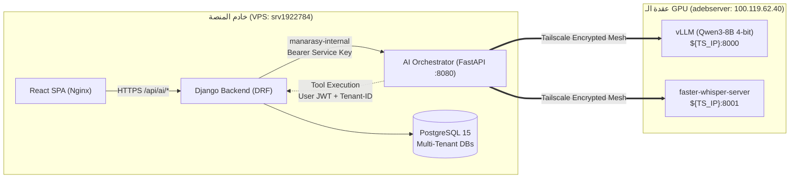

# بيئة الذكاء الاصطناعي الإنتاجية لمنصة «منارة» (Manarasy AI Production Stack)

توثيق المعمارية، وحساب ميزانية ذاكرة الـ GPU، والتشغيل، واستكشاف الأعطال، والنسخ الاحتياطي والاستعادة لطبقة الذكاء الاصطناعي في منصة **منارة**.

---

## 1. المعمارية العامة (Architecture)



### المبادئ الهندسية والأمنية:
1. **عدم الاتصال المباشر بالنموذج:** تطبيق Django لا يتصل بـ `vLLM` أو `STT` مباشرة، بل يتصل حصراً بخدمة `manarasy-orchestrator` داخل شبكة Docker المعزولة (`manarasy-internal`) باستخدام مفتاح خدمة سري (`ORCHESTRATOR_SERVICE_KEY`) يُفحص بمقارنة آمنة زمنياً (`hmac.compare_digest`).
2. **عدم تعريض أي منفذ على `0.0.0.0`:** على جهاز الـ GPU (`adebserver`)، تُربط المنافذ بعنوان Tailscale فقط عبر `${TS_IP}:8000:8000` و`${TS_IP}:8001:8000`.
3. **السقوط الآمن (Graceful Degradation):** إذا كان جهاز الـ GPU مطفأً أو بطيئاً أو فُتح الـ Circuit Breaker، تستمر منصة منارة بالعمل بشكل طبيعي تماماً مع عرض رسائل بديلة لطيفة دون إسقاط أي صفحة.
4. **حماية الخصوصية (PII Redaction) وعزل الأدوار (RBAC):** يتم تجريد أرقام الهويات الوطنية والهواتف والعناوين والدخل وحالة اليتم قبل مغادرة الطلب لـ Django وداخل الـ Orchestrator، مع عزل مدخلات المستخدم داخل `<user_input>` وتعقيم المخرجات ضد XSS ووسوم `<think>`.

---

## 2. ميزانية ذاكرة البطاقة (RTX 5070 Ti - 16GB VRAM)

| البند | الحجم بـ GB | الحجم بـ MiB | ملاحظات |
| :--- | :--- | :--- | :--- |
| **إجمالي ذاكرة البطاقة** | `16.00 GB` | `16,384 MiB` | NVIDIA RTX 5070 Ti |
| **مستخدم من خدمات أخرى (بما فيها STT)** | `6.40 GB` | `~6,554 MiB` | خدمات عاملة مسبقاً على `adebserver` |
| **الذاكرة الحرة المتاحة قبل vLLM** | `9.60 GB` | `~9,830 MiB` | `16.0 - 6.4 = 9.6 GB` |
| **مخصص لـ vLLM (`Qwen3-8B` 4-bit NF4)** | `6.40 GB` | `~6,554 MiB` | `--gpu-memory-utilization 0.40` (الأوزان ~4.65GB + KV-Cache لـ `max-model-len=4096` و`max-num-seqs=4` ~0.9GB + CUDA context ~0.8GB) |
| **الهامش الحر الآمن المتبقي** | **`3.20 GB`** | **`~3,276 MiB`** | **أعلى من الحد الأدنى المطلوب (`2.5 GB` / `2,500 MiB`)** |

---

## 3. خطوات التشغيل (Deployment & Startup)

### أولاً: على جهاز الـ GPU (`adebserver` - `100.119.62.40`)
1. اسحب الفرع الجديد من المستودع وانسخ ملفات `gpu-stack/` إلى `~/manarasy-ai`:
   ```bash
   git fetch origin && git checkout feat/ai-production-stack
   cp gpu-stack/docker-compose.yml gpu-stack/up.sh gpu-stack/.env.example ~/manarasy-ai/
   cd ~/manarasy-ai
   cp -n .env.example .env
   ```
2. تأكد من ضبط `.env` في `~/manarasy-ai/.env`:
   ```env
   TS_IP=100.119.62.40
   MODELS_DIR=/models
   NEED_MB=13000
   MIN_MARGIN_MB=2500
   ```
3. شغّل السكربت الآمن (يفحص الذاكرة الحرة قبل التشغيل ويتأكد من بقاء هامش $\ge$ 2.5GB بعد الإقلاع):
   ```bash
   chmod +x ~/manarasy-ai/up.sh
   ~/manarasy-ai/up.sh
   ```

### ثانياً: على خادم المنصة (VPS - `/root/manarasy`)
1. أضف متغيرات الـ Orchestrator وأعلام الميزات من [`backend/.env.example`](file:///root/manarasy/backend/.env.example) إلى `backend/.env.prod`:
   ```env
   ORCHESTRATOR_BASE_URL=http://manarasy-orchestrator:8080
   ORCHESTRATOR_SERVICE_KEY=<مفتاح-عشوائي-32-حرفاً-على-الأقل>
   VLLM_BASE_URL=http://100.119.62.40:8000/v1
   VLLM_MODEL_NAME=base
   STT_BASE_URL=http://100.119.62.40:8001/v1
   ```
2. شغّل خدمة الـ Orchestrator وتطبيق منارة:
   ```bash
   docker compose up -d --build manarasy-orchestrator manarasy-backend
   ```

---

## 4. تشغيل الاختبارات والتقييم الذهبي واختبار الحمل

- **اختبارات وحدات وتكامل الـ Orchestrator (8 اختبارات شاملة):**
  ```bash
  cd /root/manarasy/orchestrator
  /root/manarasy/agent_gateway/.venv/bin/python -m pytest -v
  ```
- **اختبارات Django للخصوصية والأدوار والاعتمادية (6 اختبارات):**
  ```bash
  cd /root/manarasy/backend
  python3 -c "import os, django; os.environ.setdefault('DJANGO_SETTINGS_MODULE', 'config.settings'); django.setup(); import unittest; suite = unittest.defaultTestLoader.loadTestsFromName('core_system.ai_assistant.tests'); res = unittest.TextTestRunner(verbosity=2).run(suite); exit(0 if res.wasSuccessful() else 1)"
  ```
- **سكربت التقييم الذهبي بالعربية (16 سؤالاً بالفصحى والسورية والقطرية):**
  ```bash
  # وضع المحاكاة المرجعي (CI/CD):
  /root/manarasy/agent_gateway/.venv/bin/python /root/manarasy/orchestrator/eval/evaluate_golden.py

  # وضع القياس الحي على Qwen3-8B الفعلي بعد تشغيل عقدة الـ GPU:
  EVAL_LIVE_VLLM=1 VLLM_BASE_URL=http://100.119.62.40:8000/v1 /root/manarasy/agent_gateway/.venv/bin/python /root/manarasy/orchestrator/eval/evaluate_golden.py
  ```
- **بوابة قبول المحوّل (تُشغَّل على الشبكة الخاصة مع الـ GPU قبل اعتماد أي محوّل):**
  ```bash
  PY=/root/manarasy/agent_gateway/.venv/bin/python
  export VLLM_CHAT_URL=http://100.119.62.40:8000/v1/chat/completions EVAL_MODELS=base,manarasy
  cd /root/manarasy/orchestrator/eval
  $PY independent_eval_ar.py      # 46 حالة بلهجات متعددة (يستبعد المتسرّب من التدريب) -> gpu-stack/data/independent_eval_<model>.json
  $PY generate_general_data.py    # (مرة واحدة) يولّد أسئلة الكتابة الحرة الخارجة عن التدريب
  $PY free_text_eval_ar.py        # CJK ونسبة العربية والطول -> gpu-stack/data/free_text_eval.json
  $PY ab_endpoints.py             # A/B لنقطتي evaluation-note وreport-insight قبل تثبيت التوجيه
  cd /root/manarasy/gpu-stack/training
  $PY compare_eval.py --before ../data/eval_report_reference_mock.json --after <تقرير ذهبي للمحوّل> \
      --independent-before ../data/independent_eval_base.json --independent-after ../data/independent_eval_manarasy.json \
      --free-text ../data/free_text_eval.json --free-text-model manarasy --free-text-base base --cjk-margin 0.05
  ```
  الشرطان الإضافيان: (1) عدم تراجع الأدوات/الأمان على المجموعة المستقلة، (2) نسبة إجابات CJK في الكتابة الحرة ≤ نسبة النموذج الأساسي + الهامش.
  لبناء بيانات تدريب مختلطة: `gpu-stack/training/build_mixed_dataset.py` بعد `generate_general_data.py`.
- **توجيه النماذج:** `/v1/agent/turn` => `VLLM_MODEL_AGENT` (manarasy)؛ بقية النقاط => `VLLM_MODEL_TEXT` (base)؛ `VLLM_MODEL_FALLBACK` لإعادة المحاولة عند ظهور حروف CJK
  (المقياس `cjk_guard_total{action,endpoint}`). للنقطتين `VLLM_MODEL_EVALUATION_NOTE` و`VLLM_MODEL_REPORT_INSIGHT` تجاوز اختياري بعد A/B.
- **اختبار الحمل والتزامن (Load Test):**
  ```bash
  /root/manarasy/agent_gateway/.venv/bin/python /root/manarasy/orchestrator/tests/load_test.py
  ```

---

## 5. استكشاف الأعطال (Troubleshooting)

1. **`up.sh` يتوقف برسالة `الذاكرة الحرة أقل من الحد المطلوب (13000MB)`:**
   - للتحديث أو إعادة التشغيل والـ vLLM يعمل أصلاً: `cd gpu-stack && ./up.sh restart` (يتخطى فحص الذاكرة المسبق).
   - نفّذ `nvidia-smi` على جهاز الـ GPU لمراجعة العمليات المستهلكة للـ VRAM. إذا كانت حاوية قديمة لـ `Qwen2.5-7B` لا تزال شغالة، أوقفها بـ `docker compose down` ثم أعد تشغيل `up.sh`.
2. **`/ready` في الـ Orchestrator يُرجع `503` أو `vllm_circuit: "OPEN"`:**
   - تحقق من اتصال Tailscale بين الـ VPS وعقدة الـ GPU: `tailscale ping 100.119.62.40`.
   - افحص صحة vLLM من الـ VPS: `curl -sf http://100.119.62.40:8000/health`.
   - يعيد الـ Circuit Breaker الفحص تلقائياً بعد `CB_RECOVERY_TIMEOUT_SECONDS` (الافتراضي 30 ثانية).
3. **رفض LoRA مع `bitsandbytes` في إصدار قديم من `vLLM`:**
   - إذا ظهرت رسالة عدم توافق `--enable-lora` مع `--quantization bitsandbytes` في سجل `docker logs manarasy-vllm`، احذف `--enable-lora --max-lora-rank 32` مؤقتاً من `gpu-stack/docker-compose.yml` أو حدّث صورة `vllm/vllm-openai:latest`.

---

## 6. النسخ الاحتياطي والاستعادة (Backup & Restore)

### أ. ما الذي يُنسخ احتياطياً في طبقة الذكاء الاصطناعي؟
1. **قوالب الـ Prompts المرقّمة:** `orchestrator/prompts/*.json` (متتبعة في Git).
2. **مجموعة التقييم الذهبي:** `orchestrator/eval/golden_ar.json`.
3. **محوّلات LoRA وبيانات التدريب على جهاز الـ GPU:** مجلدا `~/manarasy-ai/loras` و`~/manarasy-ai/data`.
4. **قواعد بيانات المساجد والمنصة (PostgreSQL):** تُدار عبر نظام النسخ الاحتياطي المدمج في `core_system/backups` وحجم `manarasy_postgres_data`.

### ب. أوامر النسخ الاحتياطي (Backup)
```bash
# 1. نسخ احتياطي لقوالب الـ Prompts والتقييم وإعدادات الـ Orchestrator على الـ VPS
tar -czf /root/backups-manarasy-ai-$(date +%F).tar.gz \
  /root/manarasy/orchestrator/prompts \
  /root/manarasy/orchestrator/eval \
  /root/manarasy/gpu-stack

# 2. على جهاز الـ GPU (نسخ محوّلات LoRA والبيانات)
tar -czf ~/manarasy-ai-gpu-backup-$(date +%F).tar.gz -C ~/manarasy-ai loras data .env
```

### ج. أوامر الاستعادة (Restore)
```bash
# 1. استعادة قوالب الـ Prompts على الـ VPS وإعادة تشغيل الـ Orchestrator
tar -xzf /root/backups-manarasy-ai-YYYY-MM-DD.tar.gz -C /
docker compose restart manarasy-orchestrator

# 2. استعادة محوّلات LoRA والبيانات على جهاز الـ GPU
tar -xzf ~/manarasy-ai-gpu-backup-YYYY-MM-DD.tar.gz -C ~/manarasy-ai
cd ~/manarasy-ai && ./up.sh
```

